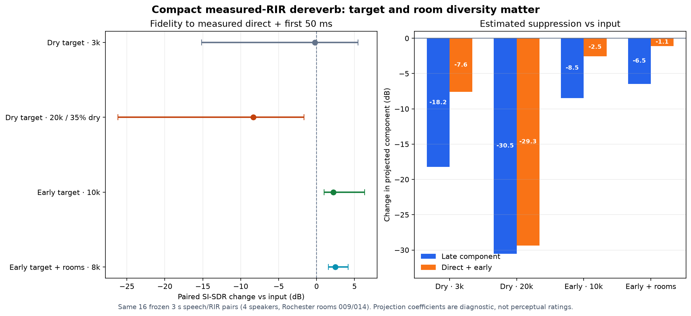

# VCTK × measured-RIR dereverberation pilot — 2026-10-11

## Question

Does replacing synthetic-only speech/reverb pairs with a cleaner speech proxy convolved with measured room responses teach the existing small dereverberator useful behavior on rooms absent from training?

This is an independent open-data experiment. It uses no Adobe audio, model output, or NDA material. It does not estimate or claim to reproduce Adobe's internal model.

## Data and procedure

- **Speech target:** 900 mic1 clips from CSTR VCTK 0.92, 24 training and 6 validation speakers. The local source manifest pins hashes and records CC BY 4.0 attribution. VCTK mic1 was recorded in a hemi-anechoic chamber; it is a close, low-reverb proxy, not an anechoic reference.
- **Room augmentation:** training uses 20% dry controls, 40% procedural RIRs, 40% measured RIRs. The best run draws 26 measured responses across 13 train rooms: six BUT ReverbDB rooms, four AIR room types, and three dEchorate rooms. Three other BUT rooms are held out by room ID for validation; two Rochester rooms are reserved for final evaluation.
- **Model:** existing 16 kHz complex-STFT residual model, 555,922 trainable parameters. No product defaults changed.
- **Fit:** Best room-diverse run: 8,000 updates on the GTX 1050 Ti, batch 1, selected on room-held-out validation (best loss 0.0426). Training took 345.8 seconds and peaked at 117.9 MiB allocated VRAM.
- **Frozen evaluation:** 16 3-second RIR-only pairs, four speakers (p239, p255, p287, p300) and two measured Rochester rooms (room009, room014), absent from this fit. These voices/rooms have been used in earlier VoxRefine experiments, so this is held out from this candidate, not a wholly unseen project-wide corpus.

## Results

| Measure on best room-diverse fit | p10 | Median | p90 |
| --- | ---: | ---: | ---: |
| Dry-proxy SI-SDR, input | -32.65 dB | -17.45 dB | -7.35 dB |
| Dry-proxy SI-SDR, enhanced | -25.62 dB | -15.14 dB | -6.66 dB |
| Paired SI-SDR change vs dry proxy | +0.21 dB | +1.95 dB | +4.30 dB |
| Paired SI-SDR change vs measured direct/early target | **+1.56 dB** | **+2.49 dB** | +4.18 dB |
| Estimated late-component coefficient change | -9.61 dB | **-6.46 dB** | -3.83 dB |
| Estimated direct/early coefficient change | -3.77 dB | **-1.10 dB** | -0.10 dB |
| Output/input RMS change | -5.22 dB | -2.82 dB | -0.93 dB |
| Dry-control RMS change | -0.16 dB | +0.01 dB | +0.01 dB |
| Dry-control SI-SDR | 30.46 dB | 38.69 dB | 39.89 dB |

Room-wise medians:

| Measured room | Late-component coefficient change | Direct/early-target SI-SDR change |
| --- | ---: | ---: |
| Rochester room009 | -4.37 dB | +2.35 dB |
| Rochester room014 | -7.55 dB | +2.67 dB |

The coefficient figures come from least-squares projection of the output onto the provided direct/early (first 50 ms) and late stems. They are diagnostics, not a perceptual score or a literal dB measurement of the reverberation tail. The paired SI-SDR comparison is also imperfect because a real room response changes phase and spectrum, but evaluating input and output against the exact paired target stem makes the direction of change interpretable.

Four model-selection experiments were evaluated on the same frozen 16 cases:

| Fit | Reverberant target | Dry-control share | Best validation loss | Early-target SI-SDR change p10 / median | Late coefficient change median | Direct/early coefficient change median | Output/input RMS change median |
| --- | --- | ---: | ---: | ---: | ---: | ---: | ---: |
| Pilot, 3k steps | fully dry | 20% | 0.0533 | -15.16 / -0.24 dB | -18.25 dB | -7.61 dB | -8.98 dB |
| Identity, 20k steps | fully dry | 35% | 0.0318 | -26.20 / -8.36 dB | -30.52 dB | -29.35 dB | -23.64 dB |
| Early target, 10k steps (best at step 8k) | direct + first 50 ms | 20% | 0.0353 | **+1.00 / +2.19 dB** | **-8.46 dB** | **-2.54 dB** | -4.43 dB |
| Early target + room diversity, 8k steps | direct + first 50 ms | 20% | 0.0426 | **+1.56 / +2.49 dB** | **-6.46 dB** | **-1.10 dB** | **-2.82 dB** |

The longer dry-target fit had the lowest validation loss but was the worst on the frozen rooms. That is why selecting a checkpoint by validation loss alone was not enough to establish useful room generalization.



The room-diverse run had no clipped outputs. On the GTX 1050 Ti, the median offline forward pass was 13.5 ms for a 3-second 16 kHz mono clip (about 223× throughput, excluding file I/O and any streaming framing/latency). The evaluator's peak allocated VRAM was 43.3 MiB. These timings do not yet establish microphone-to-virtual-device real-time performance.

## Decision

**GO for a broader open-data validation; no-go for production or any Adobe-parity claim.** The best measured gain came from a better target plus wider room diversity, not more dry controls or more updates. The room-diverse model clears aggregate screening gates: median SI-SDR to the direct/early target +2.49 dB, p10 +1.56 dB; both test rooms positive; direct/early coefficient change -1.10 dB median; late coefficient change -6.46 dB median; output level -2.82 dB median / -5.22 dB p10; dry controls +0.01 dB median. One of 16 clips regressed by 1.29 dB SI-SDR and had a -6.01 dB direct/early coefficient shift; it did not hit the predeclared collapse veto because output RMS was -5.81 dB, not below -10 dB. No case hit the combined collapse condition. The 35%-dry, 20k-step experiment shows why a lower validation loss alone is misleading: its output fell 23.64 dB relative to reverberant input and its direct/early SI-SDR regressed 8.36 dB median. The current candidate still rests on 16 cases in only two final rooms, changes direct/early speech, and may retain audible early room character. It is not a product release or a universal result.

This isolates the main limit more clearly: the compact network can learn useful dereverberation from paired measured-RIR data on the old GPU. A dry target led to over-suppression; a direct-plus-early target and a room-disjoint training/validation split improved both held-out Rochester rooms. The next useful experiment is a wider independent test across more unseen rooms and more speakers, then a listener check. Keep all checkpoints experimental and leave product behavior unchanged.

## Reproduction

```bash
.tools/resemble-venv/bin/python scripts/benchmarks/universal_enhancer/compact_dereverb/train_vctk_measured_mix.py --steps 3000 --device cuda
.tools/resemble-venv/bin/python scripts/benchmarks/universal_enhancer/compact_dereverb/evaluate_vctk_measured_mix.py
```

The best current candidate used:

```bash
.tools/resemble-venv/bin/python scripts/benchmarks/universal_enhancer/compact_dereverb/train_vctk_measured_mix.py --steps 8000 --target-early --dry-probability 0.20 --room-heldout-validation --extra-rir-root .tools/compact-dereverb/data/dechorate/extracted-v2 --extra-rir-root .tools/compact-dereverb/data/air/extracted --validate-every 1000 --log-every 1000 --output-dir .tools/compact-dereverb/vctk-room-diverse-early-target-8k-2026-10-11 --device cuda
.tools/resemble-venv/bin/python scripts/benchmarks/universal_enhancer/compact_dereverb/evaluate_vctk_measured_mix.py --checkpoint .tools/compact-dereverb/vctk-room-diverse-early-target-8k-2026-10-11/checkpoints/best-dev.pt --output .tools/compact-dereverb/vctk-room-diverse-early-target-8k-2026-10-11/evaluation
```

The ignored run artifacts, checkpoint, renders, case table, and full machine-readable summary are under `.tools/compact-dereverb/vctk-measured-room-pilot-2026-10-11/`.

## Sources

- CSTR VCTK Corpus 0.92, source page and citation: [University of Edinburgh DataShare](https://datashare.ed.ac.uk/items/30e7453c-9ea8-48b4-8e18-f96d0dc62928), DOI [10.7488/ds/2645](https://doi.org/10.7488/ds/2645).
- BUT Speech@FIT Reverb Database: [official dataset page](https://speech.fit.vut.cz/software/but-speech-fit-reverb-database).
- dEchorate measured responses: [official SOFA index](https://sofacoustics.org/data/database/dechorate/); selected SOFA files embed their MIT license.
- Aachen Impulse Response Database 1.4: [RWTH Aachen source page](https://www.iks.rwth-aachen.de/en/research/tools-downloads/databases/aachen-impulse-response-database); its included README/license records MIT.
